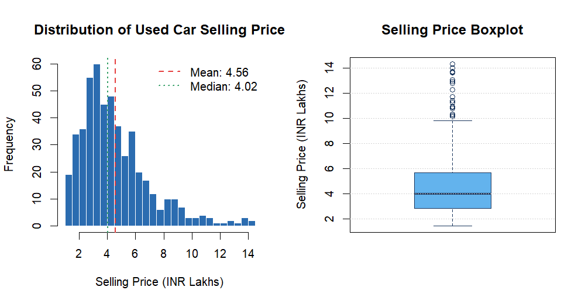
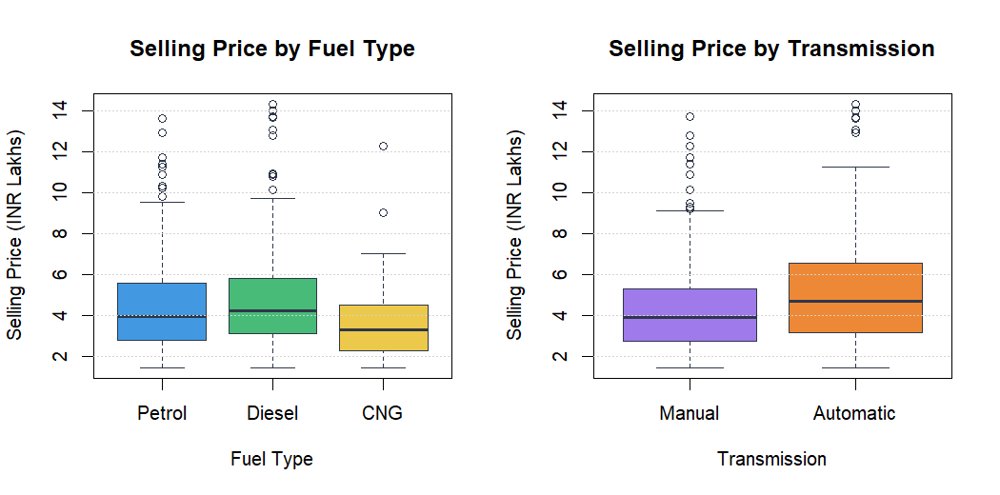
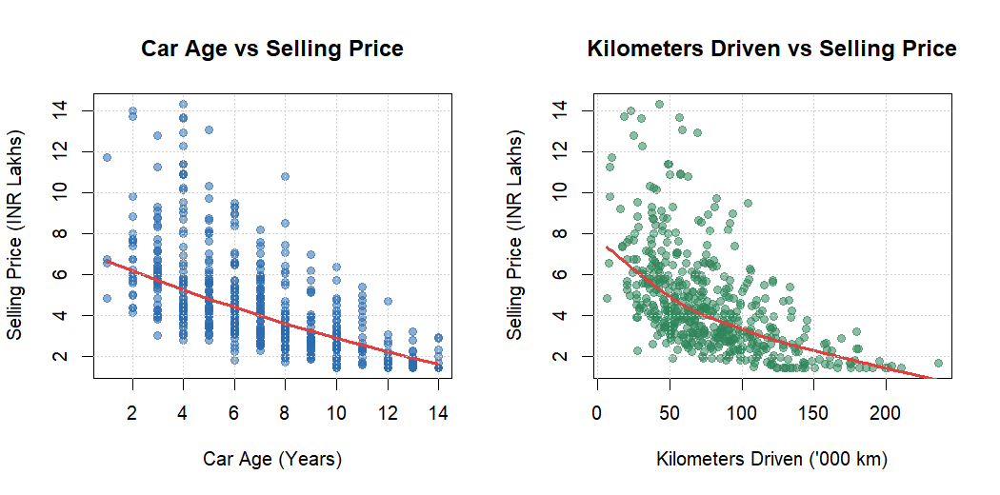
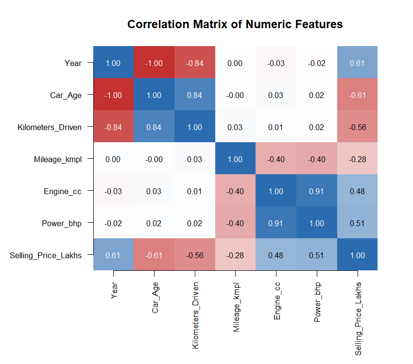
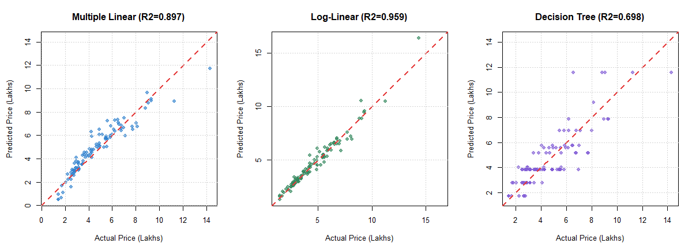
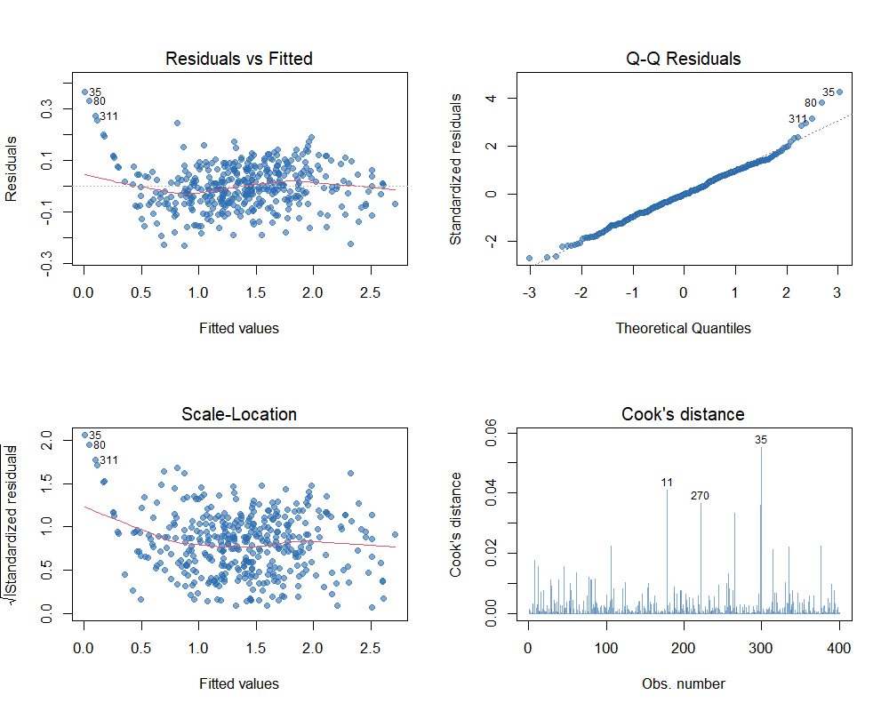
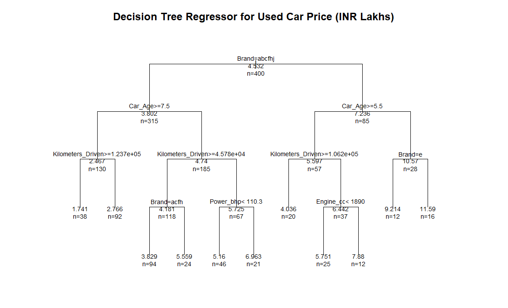

  

| Student Details | Information |
| :--- | :--- |
| **University** | Presidency University, Bengaluru |
| **Student Name** | Gutha Vishnu Vardhan Naidu |
| **Roll Number** | `20241CSD0073` |
| **Department / Section** | CSE Data Science |
| **Project Title** | Used Car Price Prediction Using R Programming |

## 1. Abstract

Determining the fair resale value of a used car is a classic regression problem influenced by vehicle age, kilometers driven, brand reputation, engine capacity, fuel type, transmission, and ownership history. In this project, we implement an end-to-end **Used Car Price Prediction** pipeline in **R** using 500 used car listings across 10 major automotive brands. After data cleaning, median imputation, and feature engineering, four predictive models are trained and evaluated on an 80/20 train-test split: **Multiple Linear Regression**, **Stepwise AIC Linear Regression**, **Log-Transformed Linear Regression**, and **Decision Tree Regression (`rpart`)**. Experimental results demonstrate that **Log-Transformed Linear Regression** achieves the highest accuracy on the unseen test set with **$R^2 = 0.9585$**, **$\text{RMSE} = 0.4600$ Lakhs**, **$\text{MAE} = 0.3028$ Lakhs**, and **$\text{MAPE} = 6.43\%$**, outperforming standard linear regression ($R^2 = 0.8966$) by capturing exponential vehicle depreciation.

---

## 2. Problem Statement & Objectives

- **Problem Statement:** Buyers and sellers in the pre-owned car market lack transparent, data-driven tools to estimate fair resale prices from vehicle specifications.
- **Objectives:**
  1. Perform data cleaning, missing-value imputation, and feature engineering in R.
  2. Conduct Exploratory Data Analysis (EDA) with statistical summaries and visual plots.
  3. Build and compare multiple regression models using `stats::lm`, `MASS::stepAIC`, and `rpart::rpart`.
  4. Evaluate models using RMSE, MAE, $R^2$, and MAPE on a held-out test set and validate residual assumptions.

---

## 3. Dataset Description

The dataset (`data/used_cars.csv`) contains **500 observations** and **12 variables**:

| Feature | Type | Description |
| :--- | :--- | :--- |
| `Car_Name` | Categorical | Brand and model name (e.g., *Hyundai Creta*, *Maruti Swift*) |
| `Brand` | Factor (10 levels) | Manufacturer (Maruti, Hyundai, Honda, Tata, Toyota, Mahindra, Kia, Volkswagen, Ford, Skoda) |
| `Year` | Numeric | Year of manufacture (2012–2025) |
| `Kilometers_Driven` | Numeric | Total distance driven (6,451 – 236,370 km) |
| `Fuel_Type` | Factor (3 levels) | Petrol, Diesel, CNG |
| `Transmission` | Factor (2 levels) | Manual, Automatic |
| `Owner_Type` | Factor (3 levels) | First, Second, Third |
| `Mileage_kmpl` | Numeric | Fuel efficiency in km/l (12.90 – 27.90) |
| `Engine_cc` | Numeric | Engine displacement in cc (796 – 2,627) |
| `Power_bhp` | Numeric | Engine peak power in bhp (56.10 – 202.30) |
| `Seats` | Factor (2 levels) | Seating capacity (5 or 7 seats) |
| `Selling_Price_Lakhs` | **Target (Numeric)** | Resale price in INR Lakhs (1.45 – 14.32) |

---

## 4. Methodology

### 4.1 Data Cleaning & Feature Engineering
- **Missing Values:** `Mileage_kmpl` had 8 missing values and `Power_bhp` had 6 missing values. Both were imputed using their respective column **medians** (`19.30 kmpl` and `106.40 bhp`) to avoid distortion from skewed observations.
- **Feature Engineering:** Created `Car_Age = 2026 - Year` to directly measure depreciation years, and converted categorical features (`Brand`, `Fuel_Type`, `Transmission`, `Owner_Type`, `Seats`) to R factors.
- **Data Partitioning:** Split the 500 records into **80% training (400 rows)** and **20% testing (100 rows)** using `set.seed(123)`.

### 4.2 Modeling Techniques
1. **Multiple Linear Regression (`stats::lm`):** Models selling price as a linear combination of all vehicle predictors.
2. **Stepwise Regression (`MASS::stepAIC`):** Performs bidirectional AIC feature selection to eliminate redundant predictors.
3. **Log-Transformed Linear Regression:** Fits $\log(\text{Selling\_Price\_Lakhs})$ against predictors to model exponential depreciation over time, using Duan's smearing correction ($\exp(\hat{y} + \hat{\sigma}^2 / 2)$) for unbiased back-transformation.
4. **Decision Tree Regressor (`rpart::rpart`):** Non-parametric recursive partitioning tree (`method = "anova"`, `cp = 0.01`, `maxdepth = 6`).

---

## 5. Exploratory Data Analysis (EDA)

### 5.1 Summary Statistics

| Feature | Min | Q1 | Median | Mean | Q3 | Max | Std. Dev |
| :--- | ---: | ---: | ---: | ---: | ---: | ---: | ---: |
| `Year` | 2012.00 | 2017.00 | 2019.00 | 2019.05 | 2021.25 | 2025.00 | 3.08 |
| `Car_Age` | 1.00 | 4.75 | 7.00 | 6.95 | 9.00 | 14.00 | 3.08 |
| `Kilometers_Driven` | 6,451 | 48,420.5 | 71,247.5 | 77,709.5 | 98,980.5 | 236,370 | 39,408.6 |
| `Mileage_kmpl` | 12.90 | 17.88 | 19.30 | 19.61 | 21.22 | 27.90 | 2.67 |
| `Engine_cc` | 796.00 | 1,239.75 | 1,427.50 | 1,451.95 | 1,652.00 | 2,627.00 | 317.10 |
| `Power_bhp` | 56.10 | 91.22 | 106.40 | 109.35 | 122.42 | 202.30 | 25.78 |
| `Selling_Price_Lakhs` | 1.45 | 2.85 | 4.02 | 4.56 | 5.68 | 14.32 | 2.44 |

### 5.2 Visual Analysis

**Key EDA Findings:**
- `Selling_Price_Lakhs` is right-skewed (Mean = 4.56 Lakhs, Median = 4.02 Lakhs), justifying logarithmic transformation.
- Automatic and Diesel vehicles command substantially higher median resale values than Manual and Petrol/CNG vehicles.
- `Car_Age` and `Kilometers_Driven` show clear negative non-linear relationships with price, while `Power_bhp` and `Engine_cc` correlate positively.

---

## 6. Model Results & Evaluation

### 6.1 Test Set Performance Comparison (n = 100)

| Rank | Model | RMSE (Lakhs) | MAE (Lakhs) | $R^2$ | MAPE (%) |
| :---: | :--- | :---: | :---: | :---: | :---: |
| **1** | **Log-Transformed Linear Regression** | **0.4600** | **0.3028** | **0.9585** | **6.43%** |
| 2 | Multiple Linear Regression | 0.7258 | 0.5230 | 0.8966 | 12.85% |
| 3 | Stepwise Linear Regression (AIC) | 0.7260 | 0.5284 | 0.8966 | 13.00% |
| 4 | Decision Tree (`rpart`) | 1.2410 | 0.9478 | 0.6977 | 21.34% |

On the training set, the **Log-Transformed Linear Regression** achieved an **Adjusted $R^2$ of 0.9707** and a log-scale Residual Standard Error of **0.089**.

### 6.2 Model Comparison & Diagnostic Plots

### 6.3 Sample Test Set Predictions

| Car Name | Year | Fuel Type | Actual Price (Lakhs) | Log-Linear Pred (Lakhs) | Linear Pred (Lakhs) |
| :--- | :---: | :--- | :---: | :---: | :---: |
| Ford Endeavour | 2019 | Petrol | 4.91 | 4.52 | 5.12 |
| Tata Altroz | 2021 | CNG | 3.46 | 3.48 | 4.30 |
| Skoda Kushaq | 2022 | CNG | 9.04 | 8.89 | 8.75 |
| Tata Harrier | 2022 | Diesel | 4.25 | 5.41 | 5.90 |
| Ford Figo | 2015 | Diesel | 2.68 | 2.65 | 2.75 |
| Maruti Swift | 2021 | Diesel | 4.91 | 5.28 | 6.05 |
| Maruti Dzire | 2023 | Petrol | 3.81 | 3.90 | 4.29 |
| Skoda Rapid | 2022 | Petrol | 6.55 | 6.45 | 6.96 |
| Volkswagen Polo | 2023 | Petrol | 7.72 | 6.92 | 6.50 |
| Kia Seltos | 2017 | Petrol | 4.04 | 3.68 | 4.28 |

### 6.4 Predictions on New Unseen Vehicles

| Brand | Car Age (yrs) | Fuel Type | Transmission | Kilometers Driven | Predicted Price (Lakhs) |
| :--- | :---: | :--- | :--- | :---: | :---: |
| Hyundai | 4 | Petrol | Automatic | 38,000 | **6.15** |
| Toyota | 3 | Diesel | Automatic | 45,000 | **17.86** |
| Maruti | 6 | CNG | Manual | 62,000 | **2.48** |

---

## 7. Conclusion & Future Work

- **Conclusion:** Modeling the log-transformed resale price captures multiplicative depreciation across car age, mileage, brand, and transmission far more accurately than additive linear models or a single decision tree, cutting test RMSE by **36.6%** (from 0.7258 to 0.4600 Lakhs) and reducing MAPE from **12.85% to 6.43%**.
- **Future Work:** Extend the pipeline with ensemble methods (Random Forest / Gradient Boosting via `randomForest` or `xgboost`), incorporate city-level market demand features, and deploy the trained R model as an interactive **R Shiny** web calculator.
